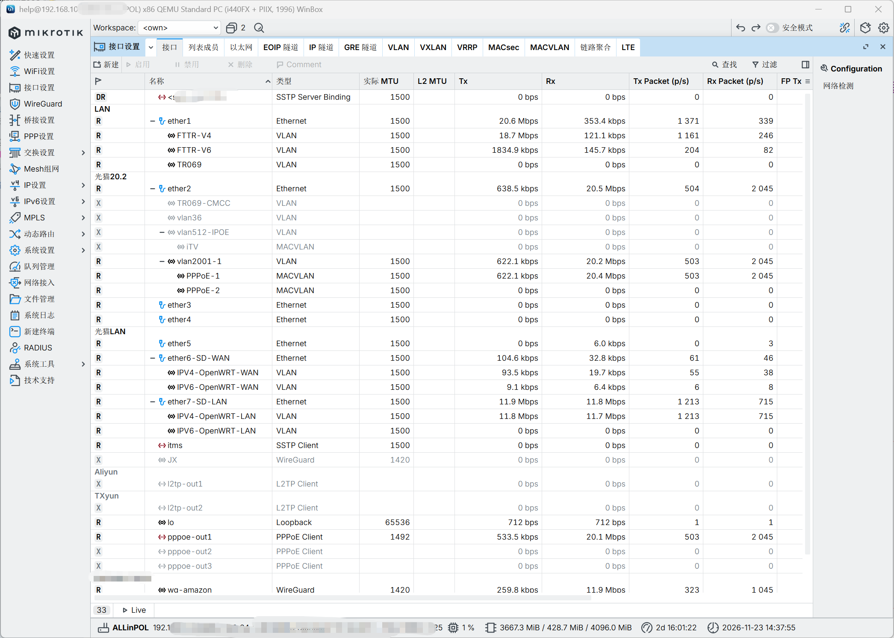
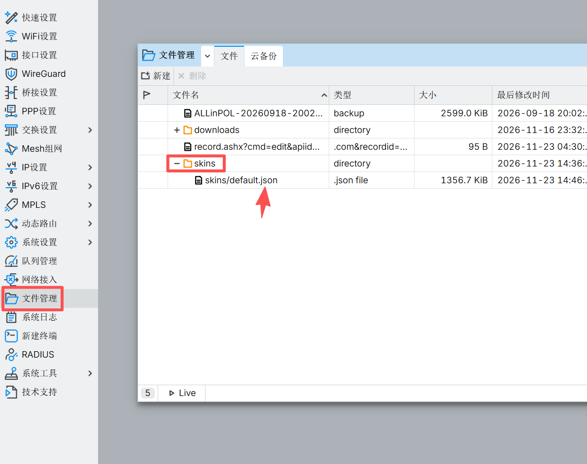
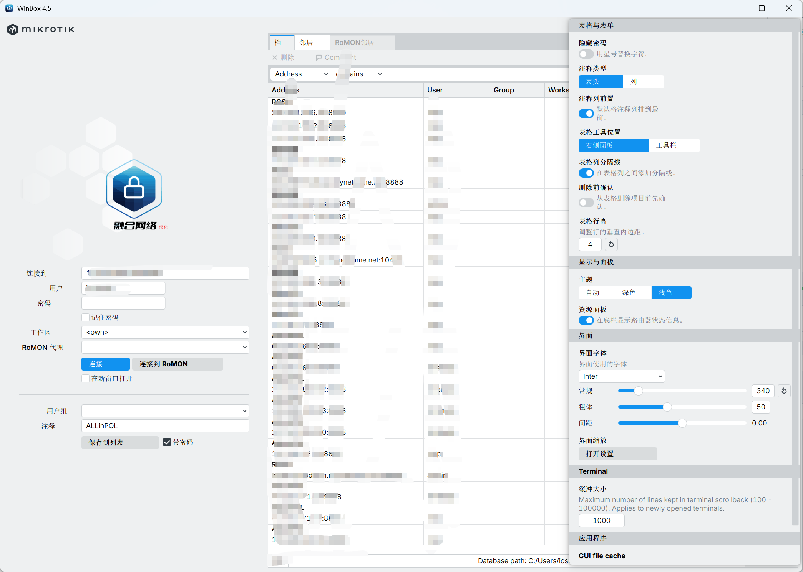
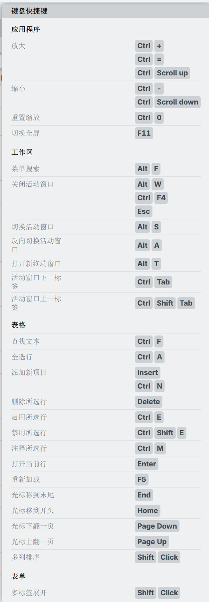
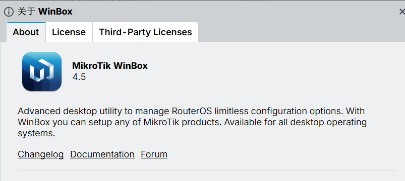

# RouterOS / WinBox 4 中文汉化

MikroTik **RouterOS 7.x** 与 **WinBox 4.x** 中文界面资源，包含：

- `skins/default.json`：设备侧菜单 / 字段汉化（WebFig + WinBox 共用）
- WinBox 4.5 窗口壳层汉化说明（登录页、右键菜单、文件上传下载等）
- 效果截图



## 适用环境

| 项目 | 说明 |
|------|------|
| RouterOS | 7.x（已按 **7.25.1** 补全 **App** 应用菜单） |
| WinBox | **4.x**（UTF-8；3.x 需另行使用 GB2312 编码的 skin） |
| WebFig | 支持 |

## 目录结构

```text
winbox4_zh/
├── README.md
├── skins/
│   └── default.json          # 上传到路由器
└── screenshots/              # 效果与操作截图
```

## 一、Skin 汉化（推荐，所有人可用）

### 安装步骤

1. 用 WinBox 连接路由器 → **文件管理（Files）**
2. 若无 `skins` 文件夹则新建一个
3. 将本仓库的 `skins/default.json` 上传到 `skins/`
4. **System → Users → User Groups**，编辑你的用户组，**Skin / 界面主题** 选 `default`
5. 重新登录 WinBox / WebFig 后生效

操作示意（上传到 `skins/default.json`）：



### 中英文共存（可选）

- 将文件改名为例如 `zh.json` 上传
- 新建用户组并指定该 skin，仅该组账号显示中文
- 原管理员账号可继续使用英文界面

### Skin 能覆盖什么

- 左侧菜单、多数列表列名、表单字段、部分操作按钮
- **App**（应用 / 网络 / 设置）等 7.25 新菜单

### 已知限制

- WinBox 4 右侧部分 **Actions** 按钮（如 `Reset Counters`）可能仍显示英文，属客户端对 skin 改名支持不完整
- 状态栏参数、部分动态动作名无法通过 skin 修改
- 上传错误编码的 JSON 可能导致乱码；WinBox 4 请使用 **UTF-8**

## 二、WinBox 4 窗口壳层汉化（仅本地自用）

部分界面文案（登录页、右键「复制」、文件「上传… / 下载…」、标题「操作」等）写在 WinBox 客户端内，**不在 skin 里**。

若你本地已自行制作汉化版客户端：

1. 关闭所有 WinBox 进程
2. 使用你自己生成的汉化副本（勿从本仓库下载 exe）
3. 配合上方 skin 使用，菜单 + 壳层更完整

本项目 **不提供**、**不托管** 修改后的 WinBox 二进制。

## 截图







## 声明

- 非 MikroTik 官方项目，与 MikroTik 无关联
- Skin 翻译可能存在不准确或未覆盖处，欢迎 Issue / PR
- 使用前请自行备份路由器配置与原版 WinBox
- 汉化仅改变显示文本，不改变 RouterOS 功能与安全性；请自行评估第三方资源风险

## License

- `skins/default.json` 中的翻译文本：以 **MIT** 许可提供（可自由使用、修改、再分发该 JSON）
- MikroTik RouterOS / WinBox 本身的版权归其权利人所有，不适用本许可
